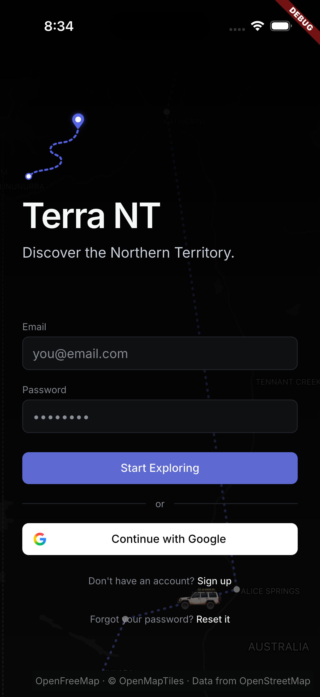

# Terra NT presentation slide plan

**Purpose:** A timed, evidence-based plan for the PRT691 group presentation. This is a slide brief, not a finished slide deck.

**Presentation limit:** 10 minutes total, including the live demonstration. The plan below targets **9 minutes 45 seconds**, leaving 15 seconds for transitions. Allow 5 minutes for questions after the presentation.

**Recommended story:** Travellers piece together safety and trip information from disconnected sources. Stakeholder and data research showed that source authority, freshness, vehicle suitability and uncertainty affect whether a trip is practical. Terra NT brings trip planning into one mobile workflow. The current implementation demonstrates the Flutter experience and a developing Gemini-backed planner, while live road evidence, deterministic safety rules and complete end-to-end evaluation remain future work.

## Slide sequence

| # | Slide title | Time | Lead speaker | Purpose |
|---:|---|---:|---|---|
| 1 | Terra NT: NT self-drive trip planning | 0:30 | Max Hoang | Introduce the project and the presentation question |
| 2 | The self-drive planning problem | 0:55 | Ahanaf Alvi | Explain the user problem, intended users and why AI may help |
| 3 | Stakeholder needs and data context | 1:05 | Shaobin Chen | Show how research changed the design priorities |
| 4 | Project evolution and system design | 1:05 | Max Hoang | Explain major changes and the chosen architecture |
| 5 | Current Terra NT implementation | 0:50 | Tarik Bulut | Demonstrate what exists now and how it relates to the target system |
| 6 | Project audit and responsible AI | 0:55 | Shaobin Chen | Present key risks, limits and controls |
| 7 | Evaluation and current evidence | 0:55 | Ahanaf Alvi | Report results with the correct prototype and test scope |
| 8 | Live demonstration | 2:35 | Max Hoang, with hand-offs | Show the principal workflow and current implementation |
| 9 | Limitations and next work | 0:55 | Tarik Bulut | Close with remaining work and a clear takeaway |
|  | **Total** | **9:45** | **All four members** |  |

The speaker split is a proposal based on the A2 report team list. Adjust it to reflect each student's actual contribution. Every member should speak and be prepared for questions about the work they present.

---

## Slide 1 — Terra NT: NT self-drive trip planning

**Time:** 0:30 · **Lead:** Max Hoang

**On-slide content**

- Terra NT
- AI-assisted self-drive trip planning for the Northern Territory
- PRT691 project team: Darwin and External 06

**Visual direction**

- Use one wide, rights-cleared image of a Northern Territory road or landscape. Prefer a real image from an official tourism or park source, with the photographer and licence/source recorded in the speaker notes.
- The app's bundled `full_nt.jpg` and `top_end.jpg` look like illustrative composite artwork. Do not caption them as documentary photographs of a named place. If the team cannot confirm usage rights, use a simple dark title slide with the Terra NT mark instead.
- Keep the title slide minimal. Do not add an agenda or dense project summary.

**Talk track**

“We are developing Terra NT, a trip-planning prototype for self-drive travel in the Northern Territory. We will show how our research shaped the design, what the current system can do, and what still needs validation.”

**Evidence:** A2 cover and project scope, pp. 1, 5. Assignment: Project Overview.

---

## Slide 2 — The self-drive planning problem

**Time:** 0:55 · **Lead:** Ahanaf Alvi

**On-slide content**

- Planning requires information from road, park, permit, fuel, weather and operator sources.
- Travellers must decide whether a route is practical for their vehicle, trip dates and experience.
- Project objective: design an advisory planner that combines route-relevant evidence and traveller constraints into an itinerary people can review.
- Primary user: the self-drive traveller. Other affected stakeholders include visitor-centre staff, small tourism operators, Aboriginal communities and responsible authorities.
- AI can help assemble and explain route-relevant information. It cannot make an unverified safety or access decision for the traveller.

**Visual direction**

- Show one route through the Darwin–Kakadu–Katherine research corridor, with source categories around it. Keep the diagram simple and readable.
- Do not use a generic chatbot graphic. Make the fragmented information problem visible.

**Talk track**

“Our problem is not a lack of travel information. It is that the information comes from different owners and changes at different rates. The planner should help travellers bring relevant information together while making the source and uncertainty clear.”

**Evidence:** A2, pp. 5–6 and 8–9. Assignment: Project Overview and stakeholder/data justification.

---

## Slide 3 — Stakeholder needs and data context

**Time:** 1:05 · **Lead:** Shaobin Chen

**On-slide content**

Use three research findings and the design decision each led to:

| Finding from A2 | Design implication |
|---|---|
| Travellers and staff combine multiple sources | Put route planning in one route-specific workflow |
| Trust depends on publisher authority and freshness | Preserve source, source type and last-checked information |
| 2WD, 4WD, towing and remote-area needs differ | Capture traveller/vehicle constraints and test suitable routes |

Add a short note: road, park, permit, fuel, weather and operator records are partial observations of changing conditions. A published record does not guarantee that a site is open or fuel is available now.

**Visual direction**

- A short evidence-to-design table or a compact source hierarchy. Give official safety/access sources visual priority; show community or operator advice as additional context.
- Suggested source names: NT Road Report, Parks Australia, Northern Land Council, BOM and operator sources. Use names on the slide; keep full URLs in notes or a small source line.

**Talk track**

“The interviews changed our priorities. Source attribution became a core requirement, and the system needs to account for vehicle and towing constraints. We also treat freshness as part of data quality. A useful answer should show what it knows, where that came from and what still needs checking.”

**Evidence:** A2, pp. 6–9, Table 1 and Table 2; appendices A and C.

---

## Slide 4 — Project evolution and system design

**Time:** 1:05 · **Lead:** Max Hoang

**On-slide content**

- **A1 concept:** broad self-drive trip planning.
- **A2 research direction:** evidence-grounded, corridor-specific decision support.
- **Current development:** separate Flutter mobile app and browser demonstration; a file-based place RAG dataset and Gemini planner service have since been added.
- **Target architecture:** retrieve evidence, check hard constraints, then use language generation to explain a reviewed itinerary.

**Visual direction**

Use a left-to-right architecture sketch:

`Authoritative and advisory sources → curated place records → Gemini planner service → structured itinerary → Flutter app and traveller review`

Add a clearly separate future component below the line:

`Planned: live road/access feeds + deterministic safety and permit rules`

Label the current knowledge-base retrieval **file-based and region-filtered**. It does not use embeddings or a vector database. Do not show live feeds or deterministic checks as implemented features.

**Talk track**

“We moved from a broad itinerary generator idea toward evidence-grounded decision support. The current server selects curated place records by region and includes them in a Gemini request. Our target design separates retrieval, deterministic checks and explanation, but the general safety rules and live data feeds are not yet implemented.”

**Evidence:** A2, pp. 5, 10–13; current `tools/plan_server/rag/README.md` and `tools/plan_server/README.md`.

---

## Slide 5 — Current Terra NT implementation

**Time:** 0:50 · **Lead:** Tarik Bulut

**On-slide content**

- Flutter app: onboarding, interactive map, itinerary/stop views and traveller route controls.
- Planner service: Gemini structured-output backend with a 12-record, source-linked place collection for the A2 corridor and the app's Red Centre route.
- Map: OpenFreeMap basemap and best-effort OSRM road geometry; straight connectors remain the offline/service-error fallback.
- Status: a direct Gemini service request returned schema-shaped itinerary output. The authenticated app-to-planner flow still needs an end-to-end sign-in and online verification.

**Visual direction**

- Use two current, clean captures: one signed-in itinerary/map and one stop/detail or onboarding screen.
- Capture them from the current iPhone build after preparing a demo account and verifying the network. Crop away the status bar, debug banner and unrelated browser/system UI where possible.
- Do not use `docs/report-figures/figure-2-terra-nt-app.png` as a current UI screenshot. It is from the A2 build and shows the earlier CARTO watermark and earlier button text. Keep it as historical A2 evidence only.
- Do not present the Apple Maps “directions unavailable” simulator capture as successful navigation evidence.

**Talk track**

“The mobile experience and the planner service are progressing as separate parts of the system. The service has returned structured Gemini output and uses our curated place records, but we have not yet verified the complete authenticated flow from the app on a connected device.”

**Evidence:** A2, pp. 10–13 for milestone baseline; current presentation tracker and planner documentation for post-A2 changes.

---

## Slide 6 — Project audit and responsible AI

**Time:** 0:55 · **Lead:** Shaobin Chen

**On-slide content**

| Risk | Current response or remaining control |
|---|---|
| Stale or incomplete road/access information | Direct users to official live checks; no live road or closure feed yet |
| Incorrect permit or cultural-access claim | Do not infer permission; rely on responsible authorities and show uncertainty |
| Fluent but unsafe recommendation | Deterministic hard checks are a target requirement, not yet a general Flutter feature |
| Privacy and account security | Keep planner authentication enabled; use de-identified research records and controlled storage |

**Visual direction**

- Use a simple risk-to-control layout with no decorative “AI brain” imagery.
- Make the status of controls visible: **in place**, **partial**, or **planned**. Do not style planned controls as completed mitigations.

**Talk track**

“Our highest-impact risk is a confident recommendation based on stale or incomplete information. The knowledge base preserves source context, but this does not make the data current. A general rules engine is still outstanding, so Terra NT remains an advisory prototype and travellers must confirm live road, park and permit conditions.”

**Evidence:** A2, pp. 14–15, Table 5 and Appendix D; current RAG dataset guidance.

---

## Slide 7 — Evaluation and current evidence

**Time:** 0:55 · **Lead:** Ahanaf Alvi

**On-slide content**

- **Browser prototype:** 9/9 predefined functional checks passed on 11 September 2026 in Chromium at a 390 × 844 mobile viewport.
- Breakdown: personalisation/scheduling 4/4; safety/evidence snapshot 2/2; human control/interaction 3/3.
- **What this result means:** preliminary functional evidence for the browser prototype and curated snapshot.
- **What it does not mean:** it does not validate the Flutter app, Gemini/RAG retrieval accuracy, current NT conditions, safety in the field or real-user trust.
- Next evaluation: known-answer retrieval and citation checks, hard-rule cases, missing-data behaviour and user/staff review.

**Visual direction**

- Use one simple 4/2/3 result graphic or a compact table. Label the build and date next to the 9/9 result.
- Avoid a large green “100% accurate” badge. The tests were functional checks, not an accuracy or safety benchmark.

**Talk track**

“We completed nine functional checks on the browser prototype. That result covers its curated demonstration behaviours only. It is not a test of the Flutter app or the newer Gemini/RAG service. Our next evaluation needs to test retrieval support, constraint handling and whether users can understand the evidence.”

**Evidence:** A2, pp. 16–17, especially Table 7 and its scope caveat; Appendix E6.

---

## Slide 8 — Live demonstration

**Time:** 2:35 · **Lead:** Max Hoang, with brief hand-offs

**Demo objective:** Show how a traveller creates or opens an itinerary, understands the route and retains control. The demo should add evidence of current functionality rather than repeat the architecture slide.

**Suggested sequence**

1. Start already signed in. Do not spend demo time on account creation.
2. Choose the Darwin–Kakadu–Katherine / Top End corridor so the demo matches the A2 research scope.
3. Generate or open the prepared itinerary. State whether the shown result came from the live Gemini service or a prepared fixture/seed.
4. Show the route and stop order. Explain that OSRM road geometry is visual route guidance and can fall back to straight connectors.
5. Open one stop, then reorder or remove/restore a stop to demonstrate traveller control.
6. Close with one sentence about checking official live road and access information before travel.

**Preparation and fallback**

- Before presentation day, verify the Firebase demo sign-in, HTTPS planner tunnel, Gemini response, map tiles and a Top End result on the exact presentation device and network.
- Confirm that the plan is generated from the Gemini endpoint rather than the fixture backend or seeded route. Keep the result ready in Saved Routes as a recovery path.
- Prepare a short screen recording only for a function that fails to demonstrate live, as permitted by the assignment. Clearly identify it as a recording.
- If the service or network fails, show the prepared local itinerary and describe the unavailable step. Do not claim a live AI generation if the demo uses a cached, fixture or seeded result.
- Do not rely on Google/Apple Maps navigation for the timed demo. The simulator previously lacked working internet and Apple Maps reported directions unavailable.

**Talk track**

“This is the traveller workflow. The planner proposes a structured route, then the user can inspect and change the itinerary. The map supports orientation, but current road and access conditions still need confirmation from official sources.”

**Evidence:** Assignment: compulsory live demonstration within 10 minutes; short backup recording may illustrate functionality that cannot be demonstrated live. A2, pp. 10–13 and 16–17 for the implementation/test boundary.

---

## Slide 9 — Limitations and next work

**Time:** 0:55 · **Lead:** Tarik Bulut

**On-slide content**

1. Verify the authenticated app-to-Gemini flow on a connected iPhone.
2. Expand the evidence model so generated itinerary facts retain source authority and freshness.
3. Add and evaluate deterministic checks for closures, access, permits and vehicle suitability.
4. Integrate live official data where available and test how stale/missing records appear to users.
5. Evaluate with travellers and relevant staff; record technical and usability outcomes.

**Closing line**

“Terra NT brings the planning workflow together. The next milestone is proving that route recommendations remain traceable and useful when the underlying conditions change.”

**Visual direction**

- End on one map or trip image and the three highest-priority next steps. Keep detailed work items for Q&A.

**Evidence:** A2, pp. 5, 8–9, 14–17; current presentation tracker and RAG dataset documentation.

---

## Slide-to-assignment coverage

| Assignment requirement | Planned slide(s) |
|---|---|
| Project overview, problem, objectives, users and AI fit | 1–2 |
| Project evolution and research-informed decisions | 3–4 |
| Current AI solution, data, method, architecture and implementation | 4–5 |
| Project audit, ethics, privacy, fairness, explainability and risks | 6 |
| Evaluation, measures, findings and limitations | 7 |
| Compulsory live demonstration | 8 |
| Future work | 9 |
| All group members contribute; professional communication within 10 minutes | Speaker plan and 9:45 timing |

The assignment weights the AI solution and live demonstration at 35%, responses to questions at 20%, evaluation/performance at 15%, and project story, design justification and communication/teamwork at 10% each. Keep the demo clear and rehearse the questions as a group.

## Visual asset checklist

- **Title photo:** obtain a rights-cleared, relevant Top End/self-drive image and keep the source and licence in speaker notes. Avoid implying an image depicts a specific closed or inaccessible site.
- **Architecture visual:** create an editable diagram from the slide 4 description. Label current components and planned components separately.
- **Flutter screenshots:** capture the current signed-in Top End route, one stop detail, and an itinerary editing action. Use a clean presentation build without the debug banner.
- **Evaluation visual:** build a simple 4/2/3 breakdown and label it “Browser prototype, 11 Sep 2026.”
- **Backup demo:** record the shortest end-to-end path once a live authenticated run succeeds. Retain the recording only as an outage fallback.
- **Attribution:** include image credits, data source names and source URLs in speaker notes or a final references slide if the group chooses to add one within the time limit.

### Existing visual references

The project already has wide NT trip artwork. It is useful as a composition reference for the title slide, but treat it as illustrative artwork rather than a documentary image of a real route or named place. Confirm its usage rights before putting it in the submitted deck.

The current OpenFreeMap login capture confirms the app's map styling and attribution. It is not a final presentation screenshot because it shows the login screen and a debug banner. Capture the signed-in itinerary flow for Slides 5 and 8.

## Claims to keep accurate

- The A2 research scope is **Darwin–Kakadu–Katherine**. The current Flutter app also contains a broader seeded **Darwin-to-Uluru** route. Identify the route shown in the demo and do not call the seeded Red Centre route the A2-tested research route.
- The **9/9** result belongs to the **browser prototype** and its curated test snapshot, not Flutter, Gemini, RAG, live data or field safety.
- The current place knowledge base is file-based and region-filtered. It does not use a vector database and does not provide live road, weather, fuel, permit, closure or booking status.
- Gemini's direct structured-output check is not the same as verified end-to-end app generation. The authenticated mobile flow still needs a connected-device rehearsal.
- Source provenance in a prompt does not guarantee that each generated claim has correct, user-inspectable source and freshness metadata.
- The app is an advisory prototype. A traveller or reviewer remains responsible for verifying current conditions and making the final decision.

## Source material

- Assignment brief: [`../../Assignment.pdf`](../../Assignment.pdf), Project Presentation section. Requirements: 10-minute maximum including demo, 5-minute question time, all members contribute, live demonstration is compulsory, and a short backup recording may show functionality that cannot be demonstrated live.
- A2 progress report: [`../../PRT691_A2_Final_Darwin%20and%20External%2006.pdf`](../../PRT691_A2_Final_Darwin%20and%20External%2006.pdf). Key sections: project evolution pp. 5; stakeholder research pp. 5–7; data context pp. 8–9; design/development pp. 9–13; responsible AI pp. 14–15; evaluation pp. 16–17.
- Current project state: [`PRESENTATION-DEMO-TRACKER.md`](PRESENTATION-DEMO-TRACKER.md), [`tools/plan_server/README.md`](../tools/plan_server/README.md), and [`tools/plan_server/rag/README.md`](../tools/plan_server/rag/README.md).
