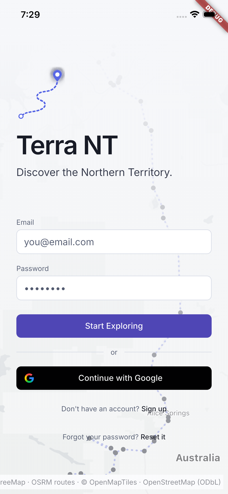
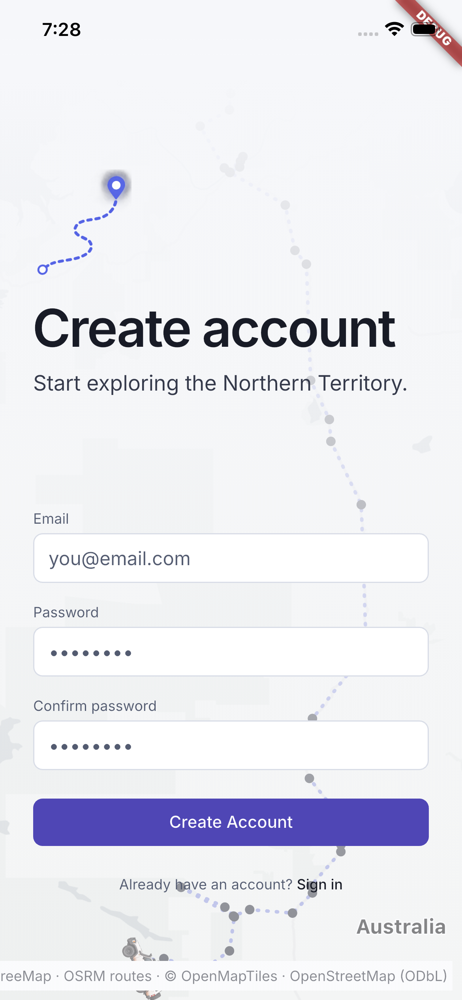
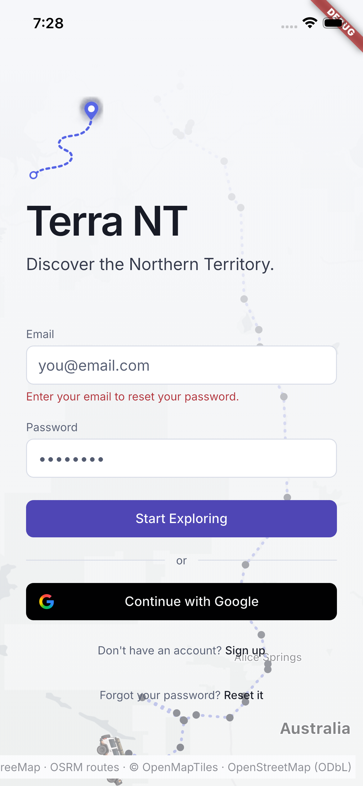

# Account access

[Back to the walkthrough](../README.md)

## 01. Sign in

**File:** [01-sign-in.png](01-sign-in.png)

**Step and description:** Fresh installation of the same existing app opens the email/password and Google sign-in screen. No credentials were entered.

## 02. Create an account

**File:** [02-create-account.png](02-create-account.png)

**Step and description:** Choose Sign up from sign-in to view email, password and password-confirmation fields. No account was created.

## 03. Password reset requires an email

**File:** [03-reset-email-required.png](03-reset-email-required.png)

**Step and description:** Tap Reset it with an empty email field to show inline guidance. No reset email was sent and no password was changed.

