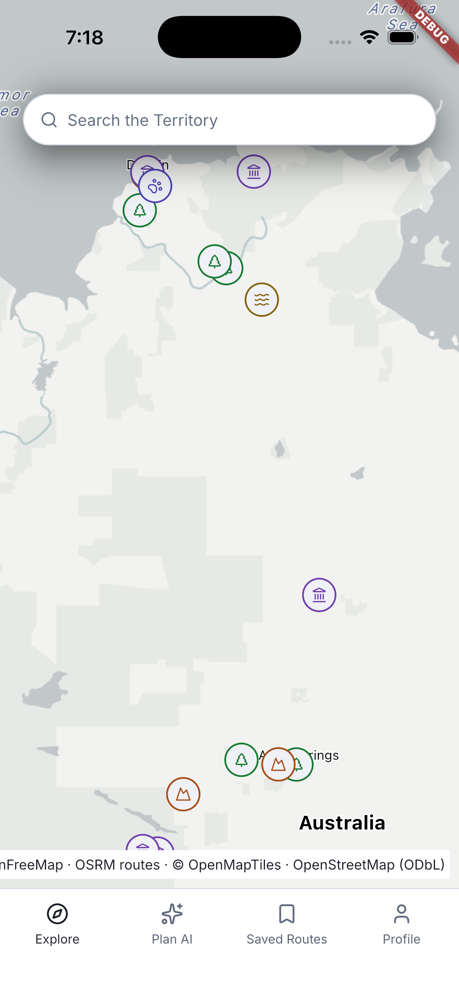
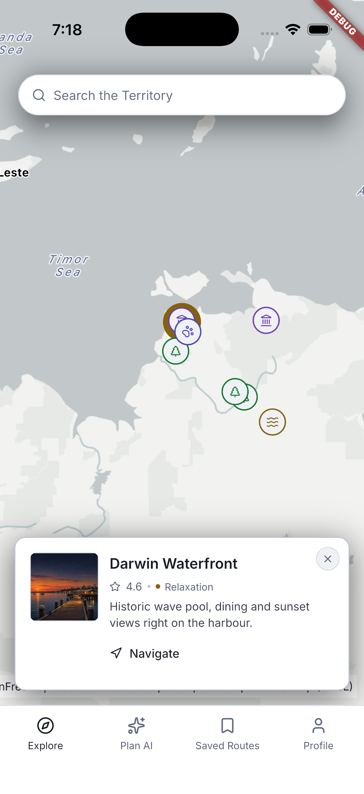
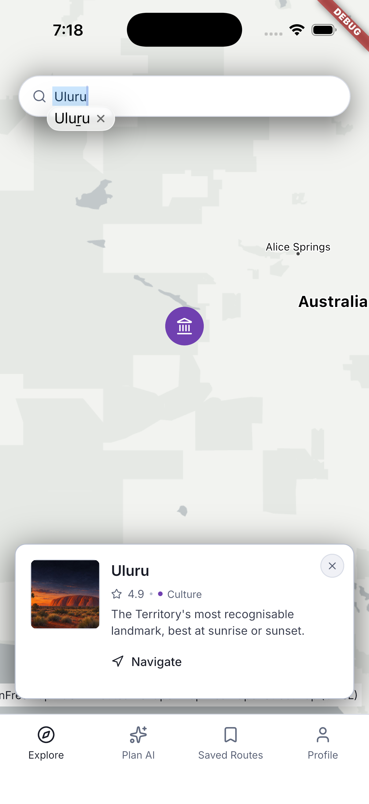
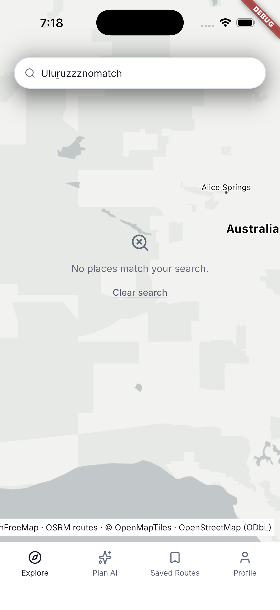

# Explore and search

[Back to the walkthrough](../README.md)

## 01. Explore — overview

**File:** [01-explore-overview.png](01-explore-overview.png)

**Step and description:** Open the Explore tab. Browse Northern Territory destinations on the light basemap before selecting a place.

## 02. Explore — place selected

**File:** [02-place-selected.png](02-place-selected.png)

**Step and description:** Tap Darwin Waterfront. The selected marker opens a place card with the existing seeded rating, tag, description and Navigate action; the rating is not a live review lookup.

## 03. Explore — search result

**File:** [03-search-single-result.png](03-search-single-result.png)

**Step and description:** Enter Uluru in Search the Territory. A single match is selected and shown with its existing place card; the keyboard remains visible.

## 04. Explore — no matching places

**File:** [04-search-no-results.png](04-search-no-results.png)

**Step and description:** Enter an unmatched search term. The app displays the no-results message and Clear search recovery action.

