# Planning questionnaire and generation

[Back to the walkthrough](../README.md)

## 01. Plan AI — before creating a route

**File:** [01-plan-empty.png](01-plan-empty.png)

**Step and description:** Open Plan AI with no active session route. Choose Plan My Route to start the questionnaire or open an existing saved route.

[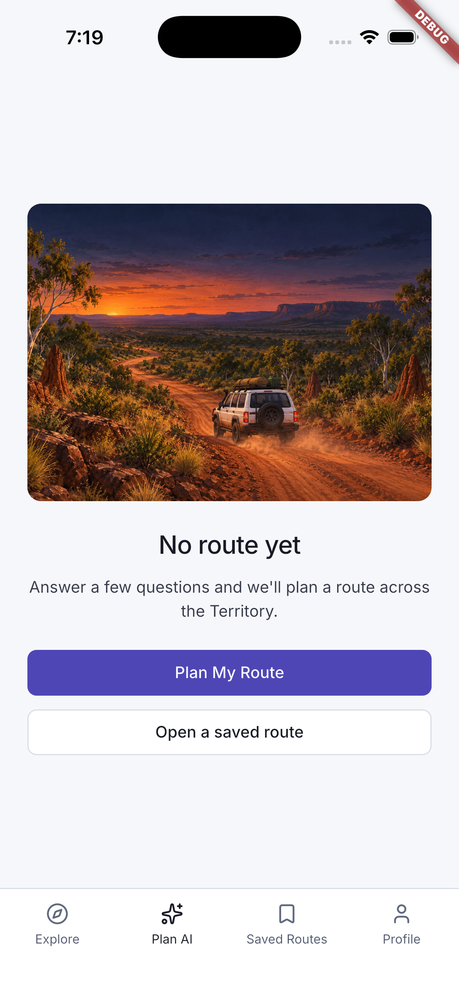](01-plan-empty.png)

## 02. Step 1 — age range

**File:** [02-step-01-age-range.png](02-step-01-age-range.png)

**Step and description:** Choose an age range to personalise the trip. The walkthrough uses a test selection, not a claim about the account holder.

[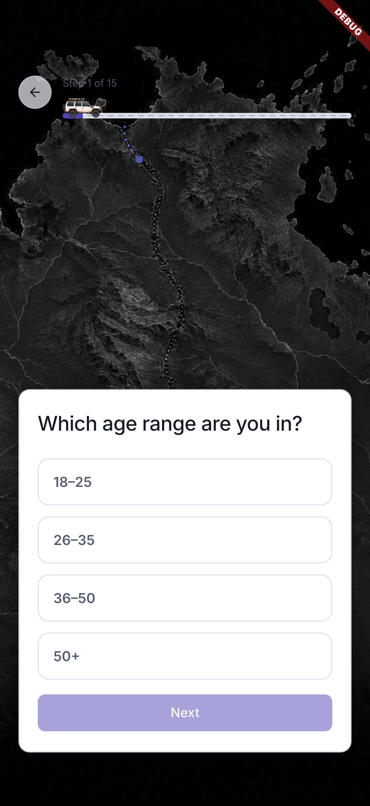](02-step-01-age-range.png)

## 03. Step 2 — trip length

**File:** [03-step-02-trip-length.png](03-step-02-trip-length.png)

**Step and description:** Adjust the trip length slider between 1 and 14 days. This walkthrough retains seven days.

[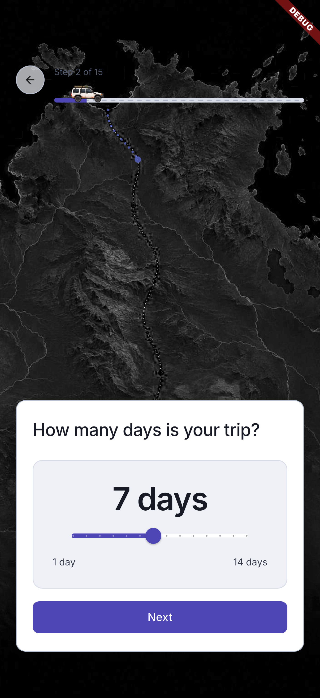](03-step-02-trip-length.png)

## 04. Step 3 — travelling companions

**File:** [04-step-03-companions.png](04-step-03-companions.png)

**Step and description:** Choose Solo, Couple, Family or Friends. This walkthrough selects Solo.

[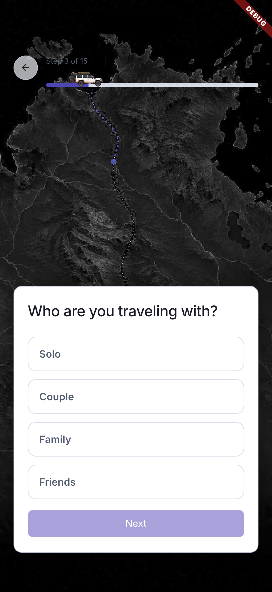](04-step-03-companions.png)

## 05. Step 4 — trip focus

**File:** [05-step-04-trip-focus.png](05-step-04-trip-focus.png)

**Step and description:** Select one or more interests: Nature, Aboriginal Culture, Adventure or Relaxation. The walkthrough chooses Nature.

[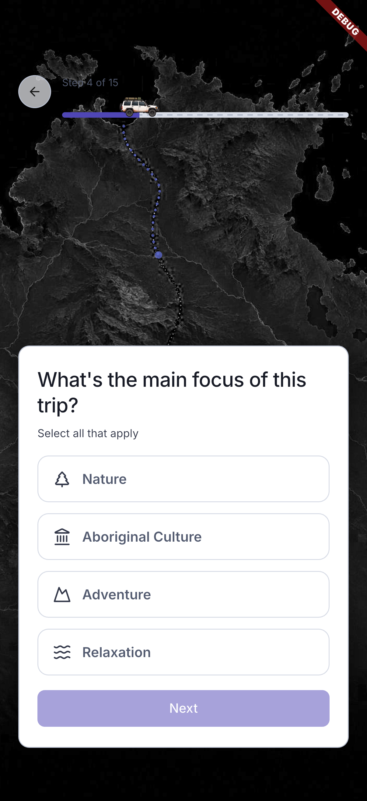](05-step-04-trip-focus.png)

## 06. Step 5 — vehicle

**File:** [06-step-05-vehicle.png](06-step-05-vehicle.png)

**Step and description:** Choose the vehicle type. This walkthrough selects 4x4 so the conditional off-road-confidence question is also captured; a standard-car trip skips that question.

[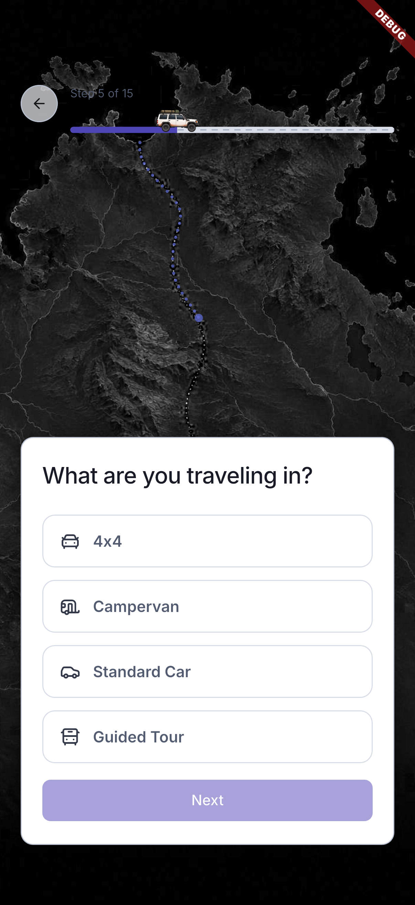](06-step-05-vehicle.png)

## 07. Step 6 — budget

**File:** [07-step-06-budget.png](07-step-06-budget.png)

**Step and description:** Choose Budget, Mid-range or Luxury. The walkthrough selects Mid-range.

[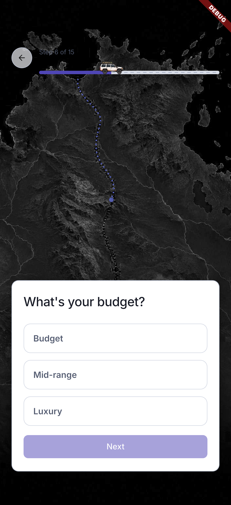](07-step-06-budget.png)

## 08. Step 7 — accommodation type

**File:** [08-step-07-accommodation.png](08-step-07-accommodation.png)

**Step and description:** Choose Camping, Motel/Cabin or Hotel. This walkthrough selects Motel/Cabin.

[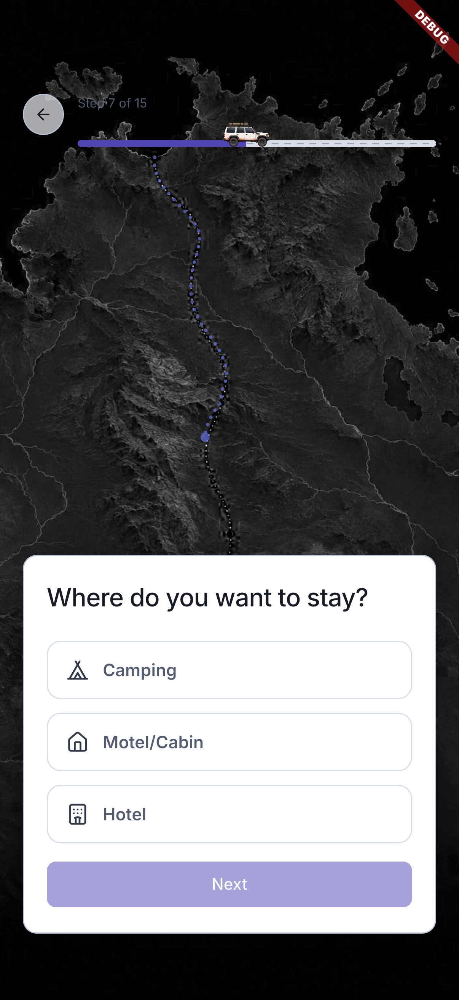](08-step-07-accommodation.png)

## 09. Step 8 — activity level

**File:** [09-step-08-activity-level.png](09-step-08-activity-level.png)

**Step and description:** Choose Low, Medium or High physical activity. This walkthrough selects Medium.

[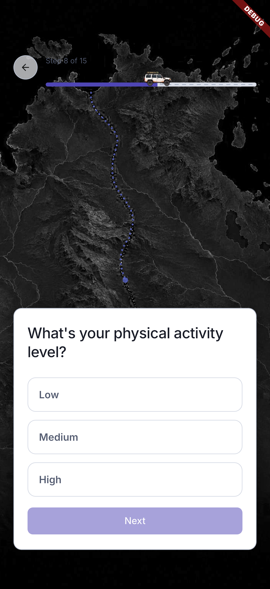](09-step-08-activity-level.png)

## 10. Step 9 — region

**File:** [10-step-09-region.png](10-step-09-region.png)

**Step and description:** Choose Top End, Red Centre or Full NT. Regional artwork illustrates each option. The walkthrough selects Top End.

[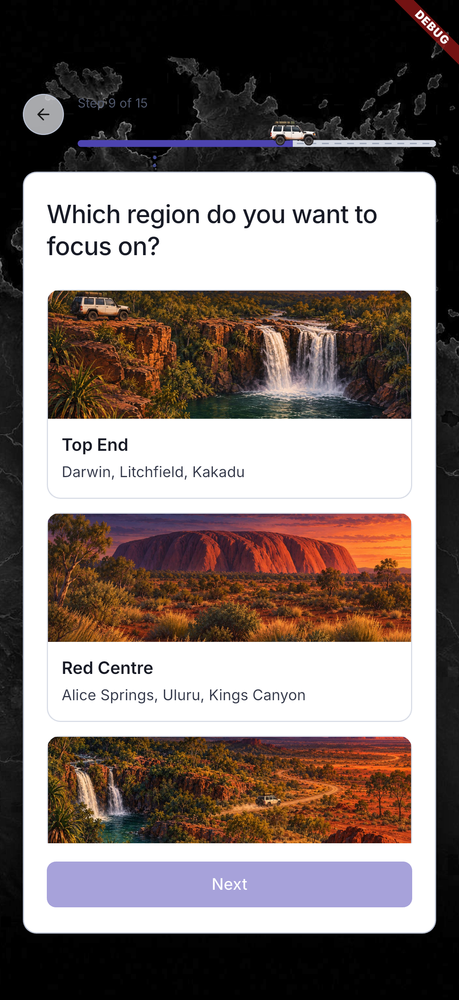](10-step-09-region.png)

## 11. Step 10 — off-road confidence (4x4 only)

**File:** [11-step-10-off-road-confidence.png](11-step-10-off-road-confidence.png)

**Step and description:** This question appears for a 4x4 trip. Choose confidence in off-road driving. Selecting a standard car skips it and reduces the displayed total to 14 steps.

[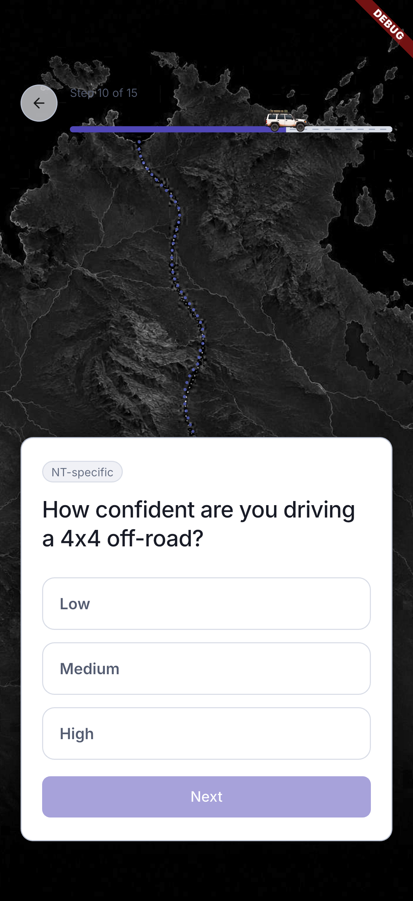](11-step-10-off-road-confidence.png)

## 12. Step 11 — heat preference

**File:** [12-step-11-heat-preference.png](12-step-11-heat-preference.png)

**Step and description:** Adjust comfort with heat using the slider. The selected sentence describes the value rather than a percentage; this is a preference, not a weather forecast.

[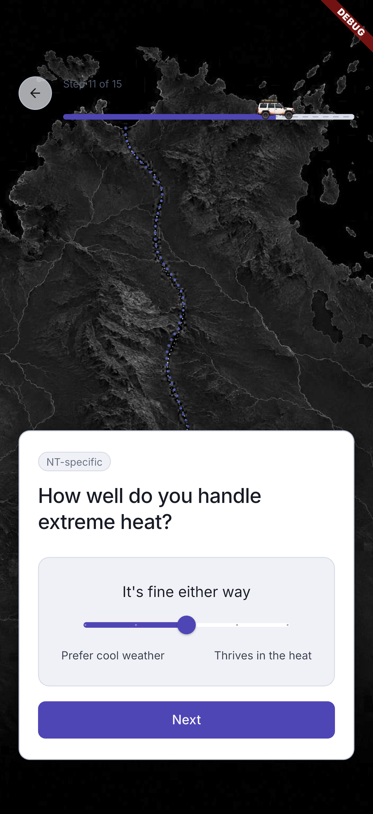](12-step-11-heat-preference.png)

## 13. Step 12 — camping versus comfort

**File:** [13-step-12-camping-comfort.png](13-step-12-camping-comfort.png)

**Step and description:** Choose Camping all the way, Bit of both or Resort comfort. This walkthrough selects Bit of both.

[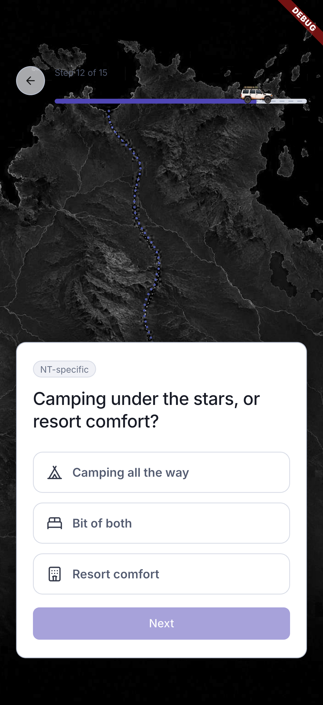](13-step-12-camping-comfort.png)

## 14. Step 13 — wildlife interest

**File:** [14-step-13-wildlife-interest.png](14-step-13-wildlife-interest.png)

**Step and description:** Choose interest in wildlife experiences. This walkthrough selects Interested.

[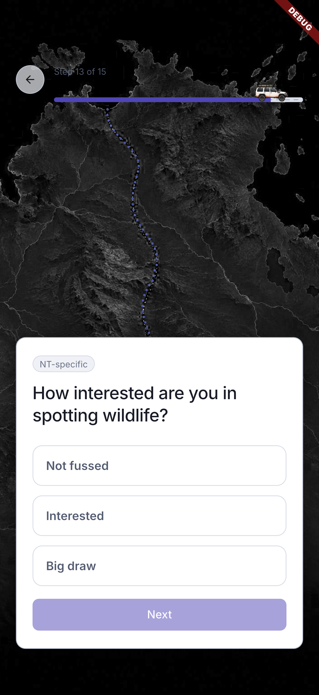](14-step-13-wildlife-interest.png)

## 15. Step 14 — connectivity preference

**File:** [15-step-14-connectivity-preference.png](15-step-14-connectivity-preference.png)

**Step and description:** Choose comfort with remote areas and limited phone signal. The preference informs planning; it does not measure coverage or internet speed.

[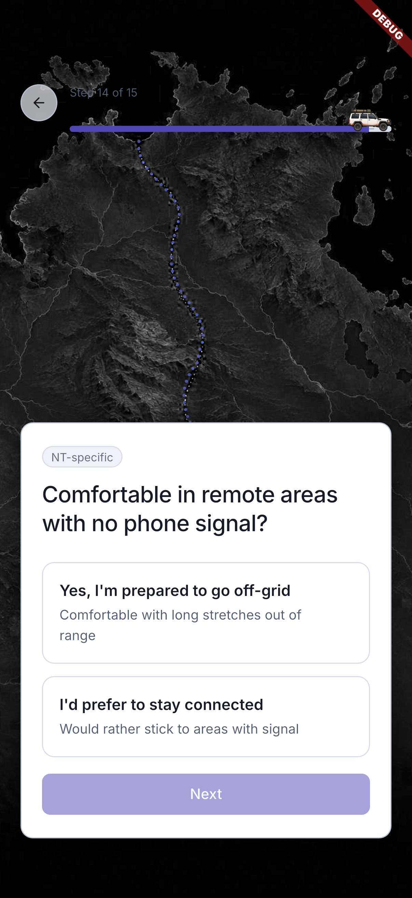](15-step-14-connectivity-preference.png)

## 16. Step 15 — start and end

**File:** [16-step-15-start-and-end.png](16-step-15-start-and-end.png)

**Step and description:** Choose starting and ending locations before generating the route. This screenshot shows the unselected endpoint fields.

[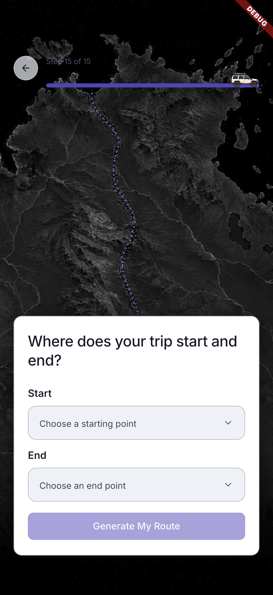](16-step-15-start-and-end.png)

## 17. Start-location menu

**File:** [17-start-location-options.png](17-start-location-options.png)

**Step and description:** Open the Start dropdown to see supported starting locations: Darwin, Jabiru, Katherine, Alice Springs and Uluru.

## 18. End-location menu

**File:** [18-end-location-options.png](18-end-location-options.png)

**Step and description:** Open the End dropdown. Choose the end location independently of the start; the walkthrough uses Katherine.

[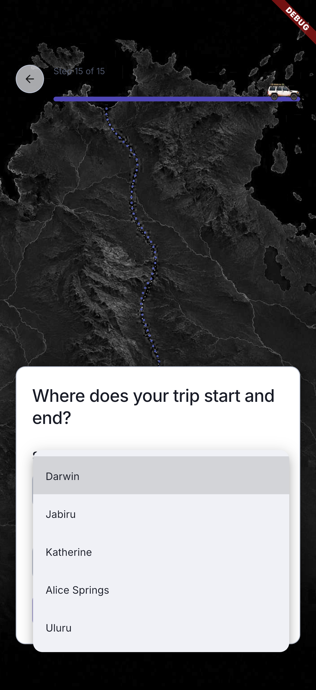](18-end-location-options.png)

## 19. Ready to generate

**File:** [19-ready-to-generate.png](19-ready-to-generate.png)

**Step and description:** All questions are answered and the trip endpoints are Darwin and Katherine. Generate My Route submits the preferences to the authenticated planner.

[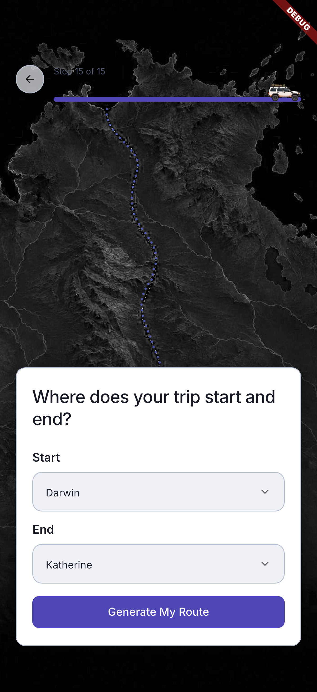](19-ready-to-generate.png)

## 20. Generating the itinerary

**File:** [20-generating-route.png](20-generating-route.png)

**Step and description:** The app sends the selected preferences to the authenticated planning backend. The loading screen shows trip context, progress copy and Cancel.

[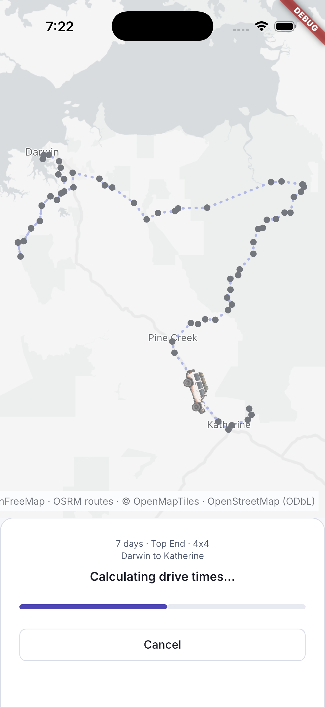](20-generating-route.png)

