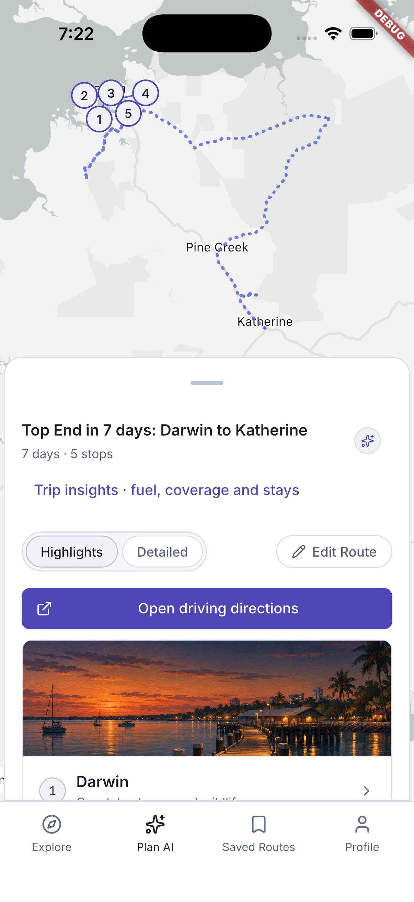
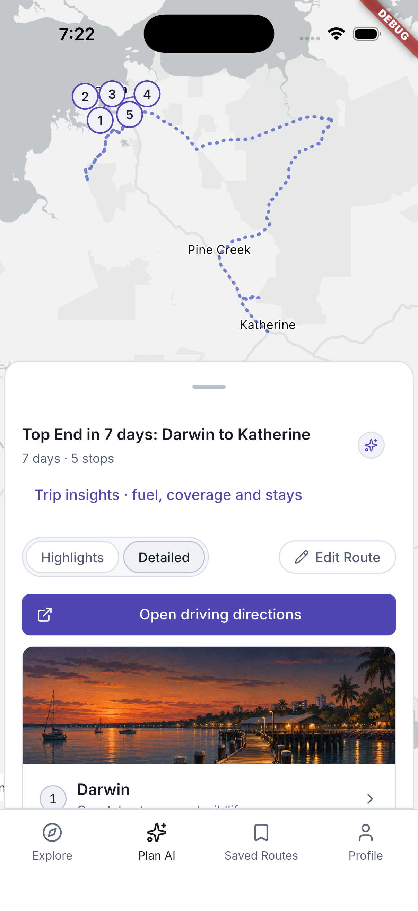
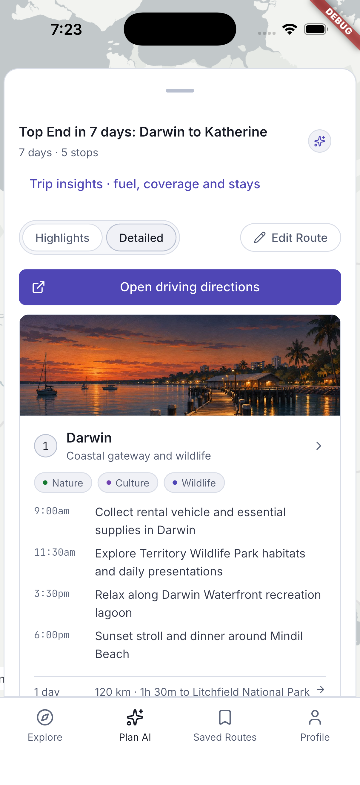
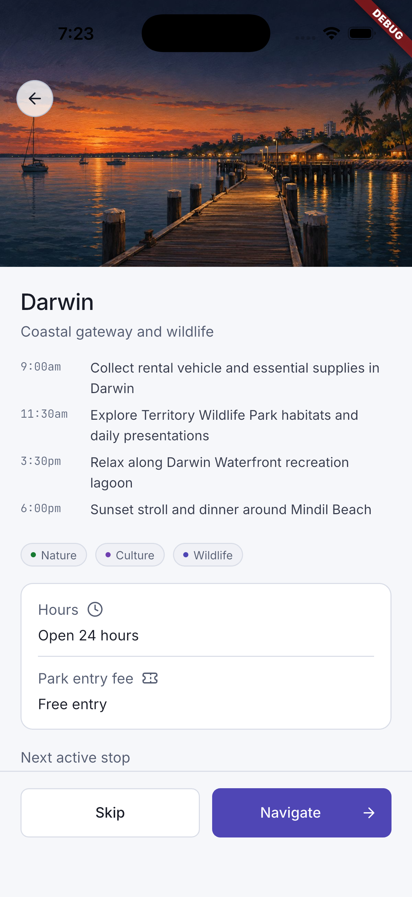
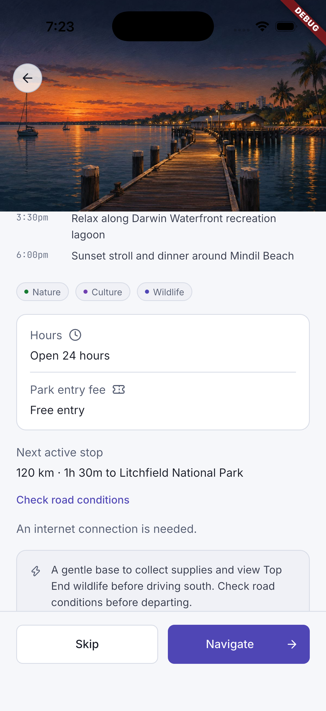
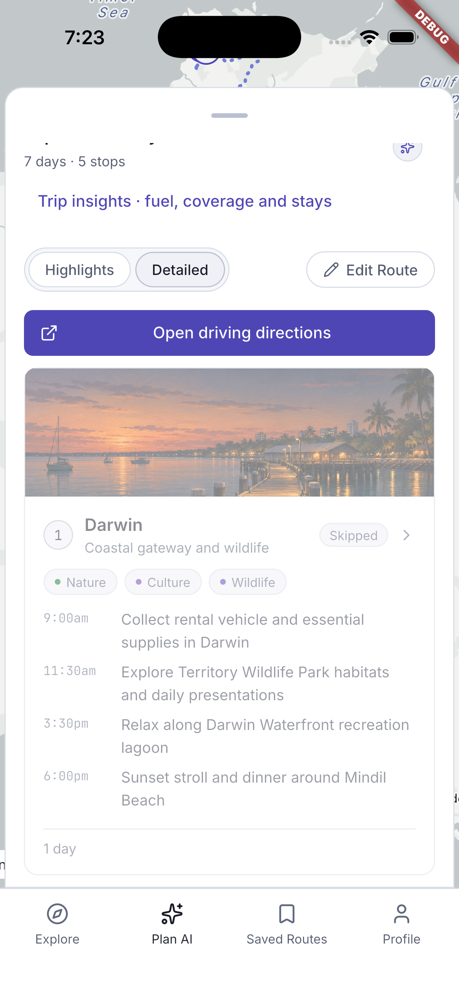
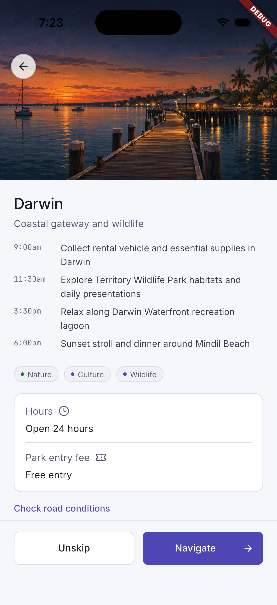
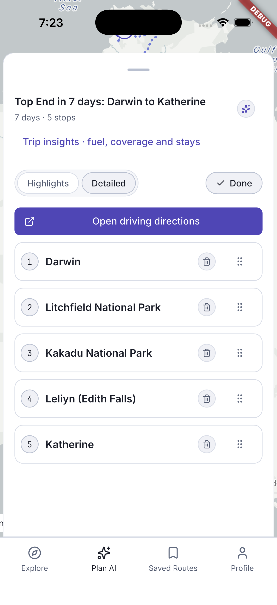
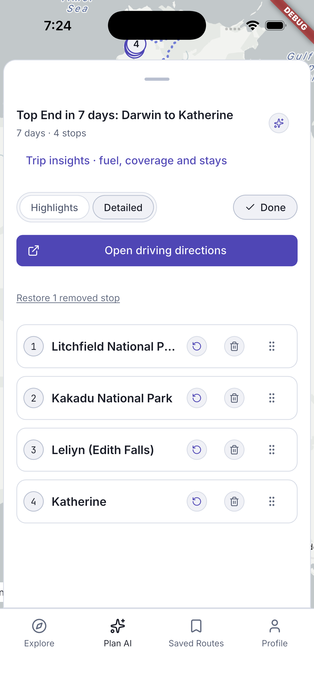

# Itinerary details and editing

[Back to the walkthrough](../README.md)

## 01. Itinerary — generated overview

**File:** [01-generated-overview.png](01-generated-overview.png)

**Step and description:** A real online generation completed for the seven-day Darwin-to-Katherine 4x4 test trip. The result shows five stops, map pins, the sheet and route actions.

## 02. Itinerary — detailed schedule

**File:** [02-detailed-mode.png](02-detailed-mode.png)

**Step and description:** Select Detailed to replace highlights with timed activities for each stop. The displayed activities come from the generated test itinerary.

## 03. Itinerary — expanded sheet

**File:** [03-expanded-sheet.png](03-expanded-sheet.png)

**Step and description:** Expand Trip stops to make more of the itinerary list visible while retaining the map behind it. The sheet also supports a collapsed state.

## 04. Stop details — Darwin

**File:** [04-stop-details.png](04-stop-details.png)

**Step and description:** Tap a stop card to open its image, timed plan, tags, display hours/fees, next leg, road-condition link and Skip/Navigate actions. Generated display facts are not verified live opening or access status.

## 05. Stop details — practical information

**File:** [05-stop-details-lower.png](05-stop-details-lower.png)

**Step and description:** Scroll the stop detail to inspect hours, fee, next active stop, the official road-condition action and the generated explanatory note.

## 06. Itinerary — skipped stop

**File:** [06-stop-skipped.png](06-stop-skipped.png)

**Step and description:** Choose Skip on the Darwin detail screen. The route returns with Darwin visibly marked Skipped; the change is session-only and can be reversed.

## 07. Stop details — unskip

**File:** [07-unskip-action.png](07-unskip-action.png)

**Step and description:** Reopen a skipped stop. Its primary route-state action is now Unskip. The walkthrough restores the stop after this capture.

## 08. Itinerary — edit mode

**File:** [08-edit-mode.png](08-edit-mode.png)

**Step and description:** Select Edit Route to expose stop reordering and per-stop remove controls. Done exits editing. These changes affect the active session route.

## 09. Itinerary — restore a removed stop

**File:** [09-removed-stop-restore.png](09-removed-stop-restore.png)

**Step and description:** Remove a stop from the active test route. The count and pin numbering update, and Restore 1 removed stop provides a reversible recovery. No saved route was deleted.

