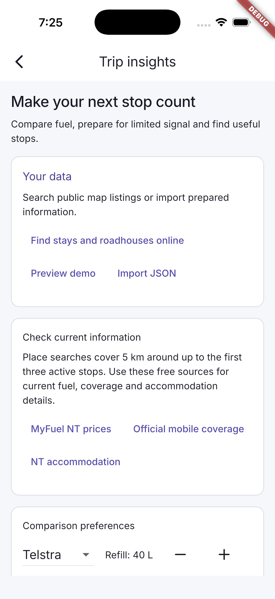
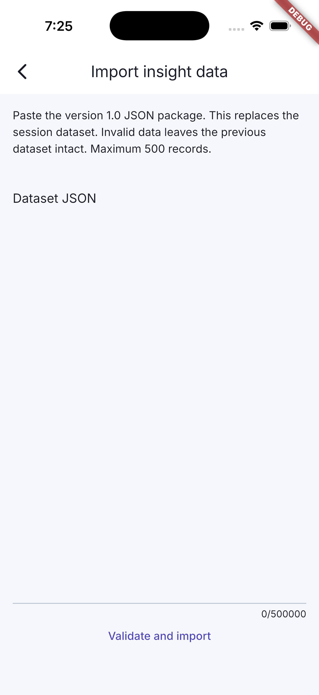
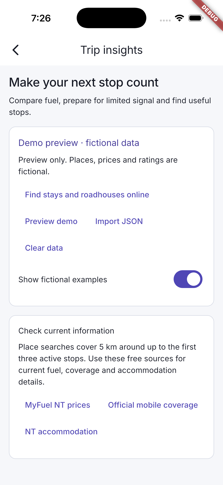
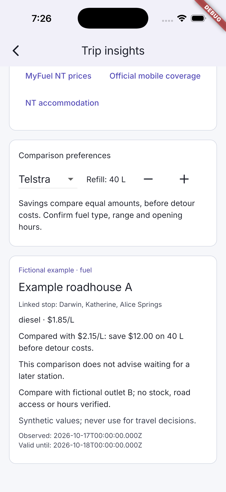
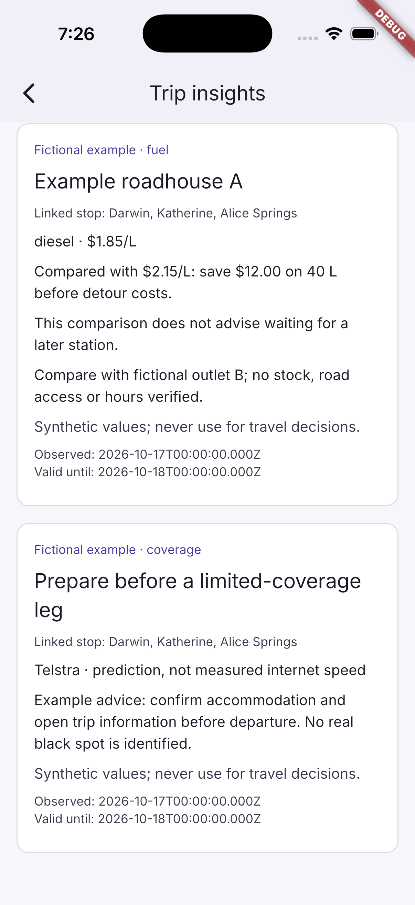
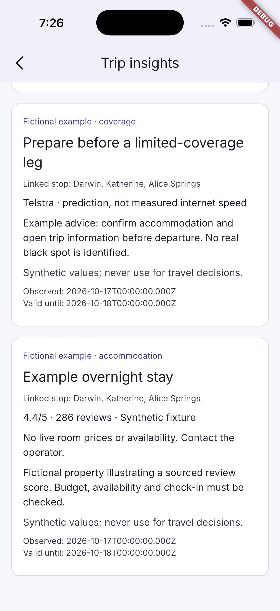
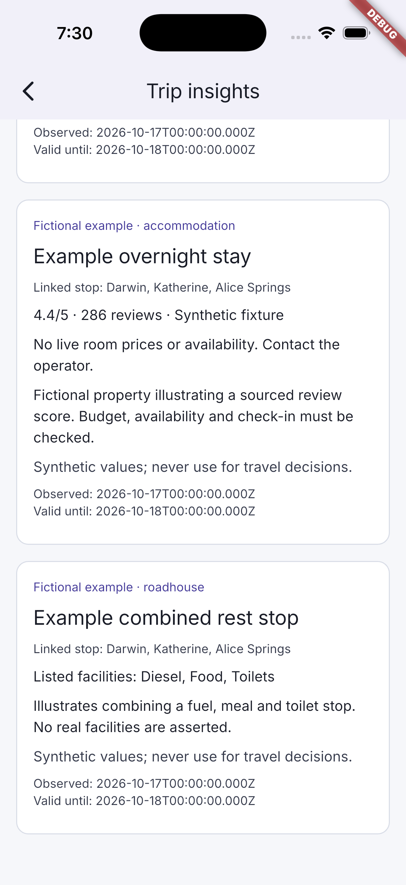

# Fuel, coverage, stays and roadhouses

[Back to the walkthrough](../README.md)

## 01. Trip insights without imported data

**File:** [01-no-data-and-public-sources.png](01-no-data-and-public-sources.png)

**Step and description:** From an itinerary, tap Trip insights. Review public source links, refill preferences and the explicit no-data state.

## 02. Import a prepared dataset

**File:** [02-import-json.png](02-import-json.png)

**Step and description:** Tap Import JSON. Paste a version 1.0 dataset, then validate and import; invalid packages preserve the existing session data.

## 03. Demo preview enabled

**File:** [03-demo-preview-enabled.png](03-demo-preview-enabled.png)

**Step and description:** Tap Preview demo. The visible banner explicitly identifies fictional places, prices and ratings; scroll down for the comparison cards.

## 04. Demo fuel savings comparison

**File:** [04-fictional-fuel-comparison.png](04-fictional-fuel-comparison.png)

**Step and description:** Scroll below preferences to view diesel at $1.85/L compared with $2.15/L, giving a fictional $12 saving on 40 litres before detour costs.

## 05. Demo connectivity preparation

**File:** [05-fictional-coverage-advice.png](05-fictional-coverage-advice.png)

**Step and description:** Continue scrolling to view the fictional Telstra coverage preparation example beneath the fuel comparison.

## 06. Demo accommodation score

**File:** [06-fictional-accommodation-rating.png](06-fictional-accommodation-rating.png)

**Step and description:** Continue scrolling to view the fictional accommodation card, showing a synthetic 4.4/5 score from 286 reviews and no live room inventory.

## 07. Demo roadhouse facilities

**File:** [07-fictional-roadhouse-facilities.png](07-fictional-roadhouse-facilities.png)

**Step and description:** Scroll to the bottom of demo insights to see the fictional combined rest stop, diesel, food and toilet facilities.

