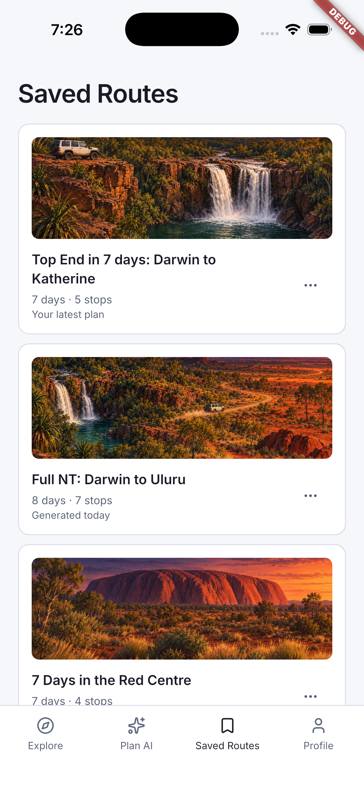
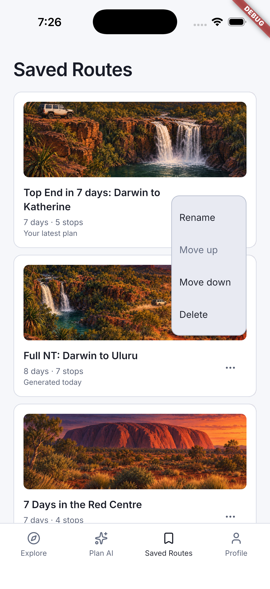
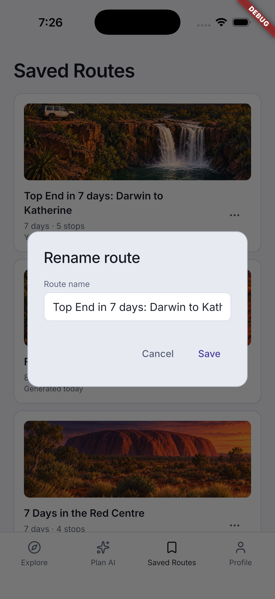

# Saved routes

[Back to the walkthrough](../README.md)

## 01. Saved routes

**File:** [01-saved-route-list.png](01-saved-route-list.png)

**Step and description:** Open Saved Routes to see the latest generated itinerary alongside existing example routes.

## 02. Saved route actions

**File:** [02-route-actions.png](02-route-actions.png)

**Step and description:** Tap the options button beside a route to rename, reorder or delete it. No saved route was deleted during this walkthrough.

## 03. Rename a saved route

**File:** [03-rename-dialog.png](03-rename-dialog.png)

**Step and description:** Choose Rename to edit the title. This capture was followed by Cancel, preserving the existing name.

