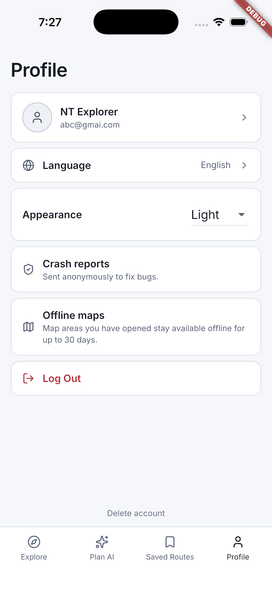
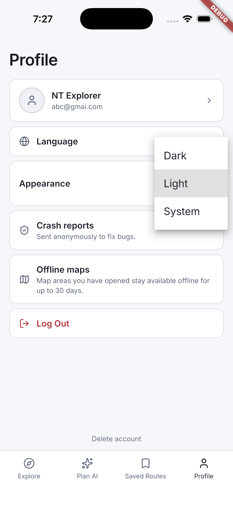
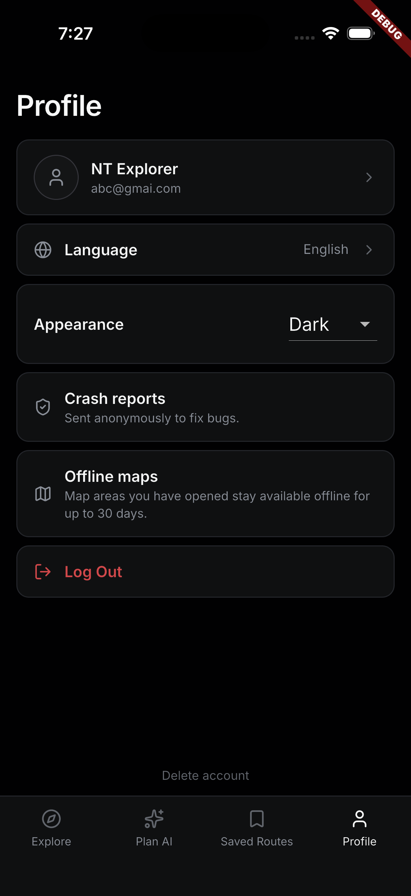

# Profile and appearance

[Back to the walkthrough](../README.md)

## 01. Profile in the default light appearance

**File:** [01-light-profile.png](01-light-profile.png)

**Step and description:** Open Profile to review language, Light appearance, crash reporting disclosure, offline map explanation and account actions.

## 02. Appearance options

**File:** [02-appearance-options.png](02-appearance-options.png)

**Step and description:** Tap the current appearance to view Dark, Light and System choices. Light remains the app default.

## 03. Optional dark appearance

**File:** [03-dark-profile.png](03-dark-profile.png)

**Step and description:** Select Dark to preview the existing alternate appearance. Light was restored after this screenshot.

