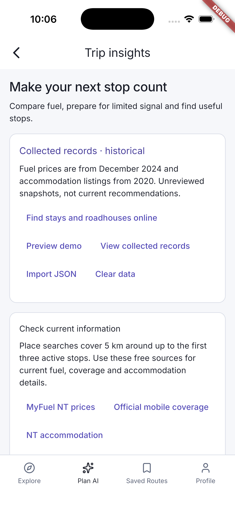
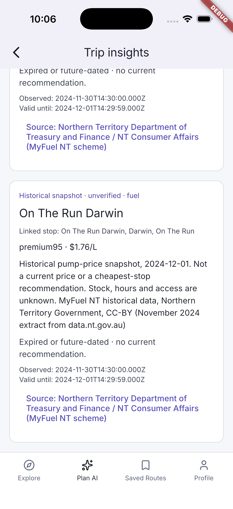

# Collected historical data — integration update

[Back to the walkthrough](../README.md) · [Integration instructions](../../../DATA-COLLECTION-INTEGRATION.md)

## 01. Collected historical data loaded

Open a saved itinerary, tap Trip insights, then View collected records. The banner states fuel is from December 2024 and accommodation listings from 2020.

## 02. Historical fuel record and source

Scroll below preferences to a collected fuel record. Its December 2024 validity interval, attribution, source link and expired status remain visible; no current savings claim is shown.

